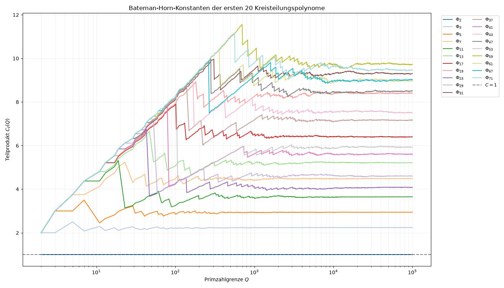
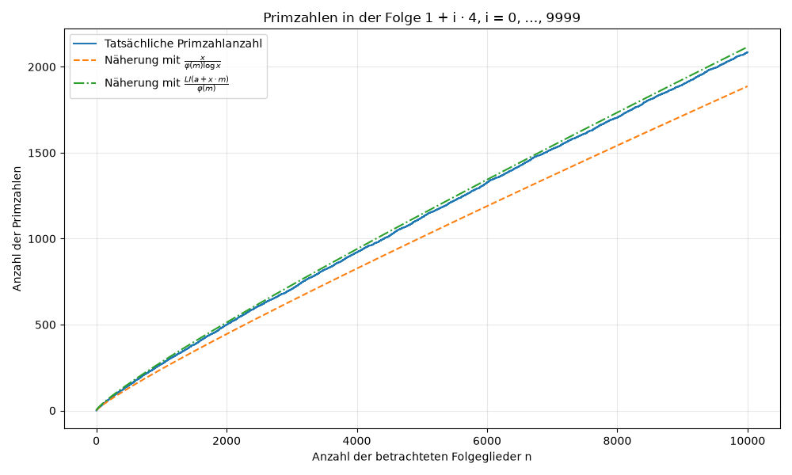
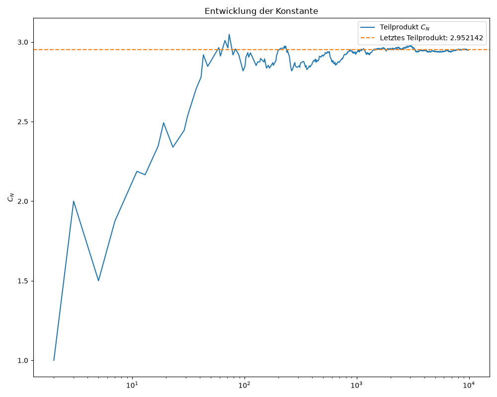
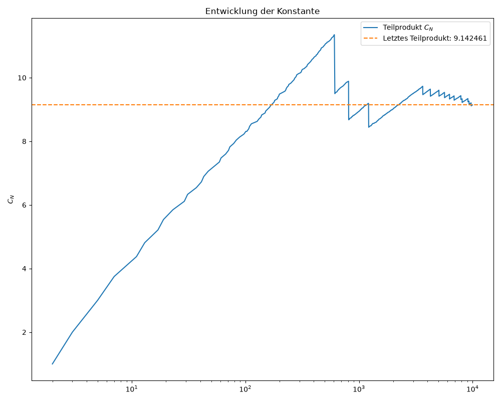

# Kunst – Zahlentheorie mit Python

Numerische Experimente und Visualisierungen zu Primzahlen, Eulerprodukten und Bateman-Horn-Konstanten. Die Sammlung untersucht Primzahlen in arithmetischen Progressionen sowie Teilprodukte für ausgewählte Polynome und Kreisteilungspolynome.



*Vergleich der Kreisteilungspolynome mit Primzahlindizes von 2 bis 71.*

## Experimente

| Skript | Inhalt | Standardeinstellung |
| --- | --- | --- |
| [arithmeticProgression.py](scripts/arithmeticProgression.py) | Zählt Primzahlen in einer arithmetischen Progression und vergleicht die Anzahl mit zwei Näherungen. | 10.000 Glieder der Folge `1 + 4i`, beginnend bei `i = 0`. |
| [KonstanteBeispiel.py](scripts/KonstanteBeispiel.py) | Stellt Teilprodukte der Bateman-Horn-Konstante für das Polynompaar $x^5+2$ und $x^4+2$ dar. | Feste Primzahlliste bis 9.973. |
| [101Kreisteilungspolynom.py](scripts/101Kreisteilungspolynom.py) | Untersucht das Eulerprodukt für das Kreisteilungspolynom $\Phi_{101}$. | Feste Primzahlliste bis 9.973. |
| [kreisteilunsploynome.py](scripts/kreisteilunsploynome.py) | Vergleicht Teilprodukte für $\Phi_\ell$, wobei $\ell$ die ersten 20 Primzahlen durchläuft. | Primzahlgrenze `cutoff = 100_000`; Ausgabe der letzten Teilprodukte im Terminal. |
| [Erster.py](scripts/Erster.py) | Explorative Sammlung mit Funktionen zum Eulerprodukt und zur Möbiusfunktion. Beim Start wird $\log(x^4+1)\log(x^5+1)$ mit $20(\log x)^2$ verglichen. | Ganzzahlige Argumente von 1 bis 99. |

## Projektstruktur

```text
Kunst/
├── README.md
├── requirements.txt
├── .gitignore
├── .gitattributes
├── scripts/
│   ├── arithmeticProgression.py
│   ├── KonstanteBeispiel.py
│   ├── 101Kreisteilungspolynom.py
│   ├── kreisteilunsploynome.py
│   └── Erster.py
└── figures/
    ├── Visualisierung_Arithmetic_Progression.png
    ├── KonvergenzKonstante.png
    ├── Kreisteilung101.png
    └── VergleichKreisteilungMitPrimordnung.png
```

- **`scripts/`** enthält die eigenständig ausführbaren Python-Experimente. Die ursprünglichen Dateinamen bleiben erhalten.
- **`figures/`** enthält die mitgelieferten PNG-Abbildungen und kann für weitere Diagramme verwendet werden.
- **`requirements.txt`** führt die benötigten Python-Pakete auf.
- **`.gitignore`** hält virtuelle Umgebungen, Python-Zwischendateien und lokale Einstellungen aus dem Repository heraus.
- **`.gitattributes`** legt einheitliche Zeilenenden für Textdateien fest und kennzeichnet PNG-Dateien als Binärdateien.

## Installation und erster Start

Benötigt werden Python 3 mit `pip` sowie eine grafische Desktop-Umgebung für die Matplotlib-Fenster. Die Abhängigkeiten sind **Matplotlib**, **NumPy**, **SciPy** und **SymPy**.

Öffne ein Terminal im Hauptordner des heruntergeladenen oder geklonten Repositorys.

### Windows / PowerShell

```powershell
python -m venv .venv
.\.venv\Scripts\python.exe -m pip install -r requirements.txt
.\.venv\Scripts\python.exe scripts/arithmeticProgression.py
```

Die Befehle verwenden Python direkt aus der virtuellen Umgebung; eine Aktivierung ist dafür nicht erforderlich.

### Linux / macOS

```bash
python3 -m venv .venv
./.venv/bin/python -m pip install -r requirements.txt
./.venv/bin/python scripts/arithmeticProgression.py
```

## Weitere Experimente starten

Führe die gewünschten Befehle einzeln im Hauptordner aus. Schließe jeweils das Diagrammfenster, um zum Terminal zurückzukehren.

```powershell
.\.venv\Scripts\python.exe scripts/KonstanteBeispiel.py
.\.venv\Scripts\python.exe scripts/101Kreisteilungspolynom.py
.\.venv\Scripts\python.exe scripts/kreisteilunsploynome.py
.\.venv\Scripts\python.exe scripts/Erster.py
```

Unter Linux und macOS ersetzt du `.\.venv\Scripts\python.exe` durch `./.venv/bin/python`.

### Parameter anpassen

Die Experimente werden über die Python-Dateien konfiguriert. Ändere dazu den jeweiligen Funktionsaufruf am Dateiende:

```python
# In scripts/arithmeticProgression.py:
malen(a=3, m=4, limit=5_000)

# In scripts/kreisteilunsploynome.py:
malen(cutoff=10_000)
```

Bei der arithmetischen Progression bezeichnet `limit` die Anzahl der betrachteten Folgeglieder; `a` und `m` müssen positive, teilerfremde ganze Zahlen sein. Beim Kreisteilungsvergleich bezeichnet `cutoff` die obere Primzahlgrenze und muss mindestens 2 betragen. Höhere Grenzen erhöhen den Rechenaufwand.

### Diagramme speichern

Die Skripte öffnen ihre Diagramme mit `plt.show()`. Über das Speichersymbol im Matplotlib-Fenster kannst du neue Abbildungen als PNG in `figures/` ablegen. Die vorhandenen PNGs werden beim Start der Skripte nicht automatisch aktualisiert.

## Mathematischer Hintergrund

Die Bateman-Horn-Vermutung beschreibt die erwartete Häufigkeit gemeinsamer Primwerte geeigneter Polynome. Die zugehörige Konstante enthält ein Eulerprodukt. In den Konstanten-Experimenten werden endliche Teilprodukte der Form

$$
C_Q = \prod_{\substack{p\leq Q\\p\;\mathrm{prim}}}
\left(1-\frac{1}{p}\right)^{-k}
\left(1-\frac{\omega(p)}{p}\right)
$$

untersucht. Dabei ist $k$ die Anzahl der Polynome und $\omega(p)$ die Anzahl der Restklassen modulo $p$, in denen ihr Produkt verschwindet. Eine ausführliche Darstellung bietet [*The Bateman-Horn Conjecture: Heuristics, History, and Applications*](https://arxiv.org/abs/1807.08899) von Soren Laing Aletheia-Zomlefer, Lenny Fukshansky und Stephan Ramon Garcia.

Für das Polynompaar $x^5+2$, $x^4+2$ gilt im Skript $k=2$; bei einem einzelnen Kreisteilungspolynom gilt $k=1$. Die Diagramme zeigen numerische Teilprodukte. Ein endlicher Kurvenverlauf liefert weder einen Beweis noch einen exakten Grenzwert.

Das Progressionsskript vergleicht die tatsächliche Primzahlanzahl mit Ausdrücken auf Basis von $x/(\varphi(m)\log x)$ und dem logarithmischen Integral, jeweils für das betrachtete Intervall. Im Programm wird das Integral ab 2 verwendet.

## Hinweise zum aktuellen Stand

- In `KonstanteBeispiel.py` und `101Kreisteilungspolynom.py` prüft `malen(limit=...)` den Parameter, verwendet ihn aber noch nicht zur Begrenzung der Berechnung.
- Diese beiden Skripte berechnen `constant(i)` für `i = 0, …, len(primes) - 1`. Der erste Punkt ist deshalb das leere Produkt `1`; der letzte Faktor der Primzahlliste wird im Diagramm nicht mehr berücksichtigt. Die Zuordnung der Teilprodukte zu den dargestellten Primzahlen ist um einen Index verschoben.
- `Erster.py`, `KonstanteBeispiel.py` und `101Kreisteilungspolynom.py` führen ihre Diagrammberechnung auch beim Import aus. Sie sind derzeit als eigenständige Skripte gedacht.
- Die Eulerprodukt- und Möbius-Plotbeispiele in `Erster.py` stehen in mehrzeiligen Zeichenketten und werden beim normalen Start nicht ausgeführt.

## Weitere Beispielabbildungen

<details>
<summary>Primzahlen in einer arithmetischen Progression</summary>



</details>

<details>
<summary>Teilprodukte für das Polynompaar</summary>



</details>

<details>
<summary>Teilprodukte für das Kreisteilungspolynom Phi 101</summary>



</details>


