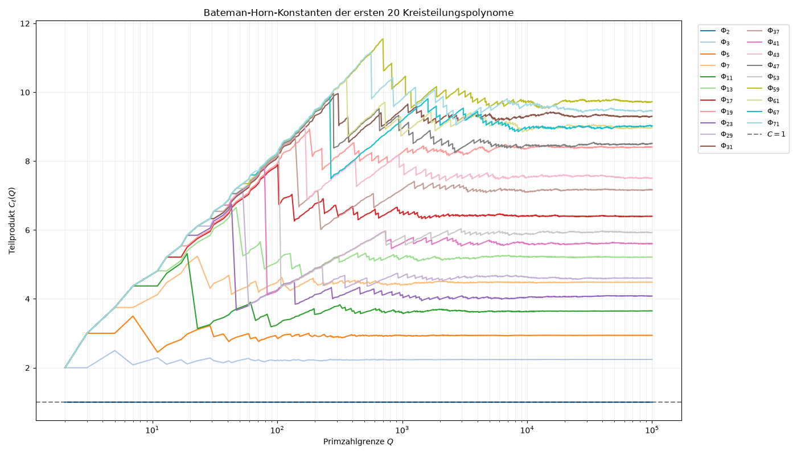
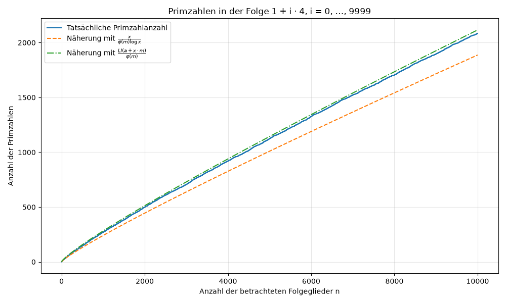
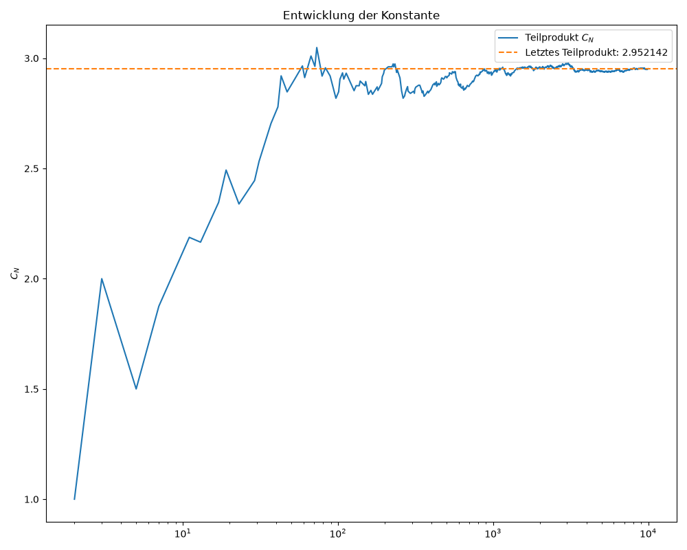
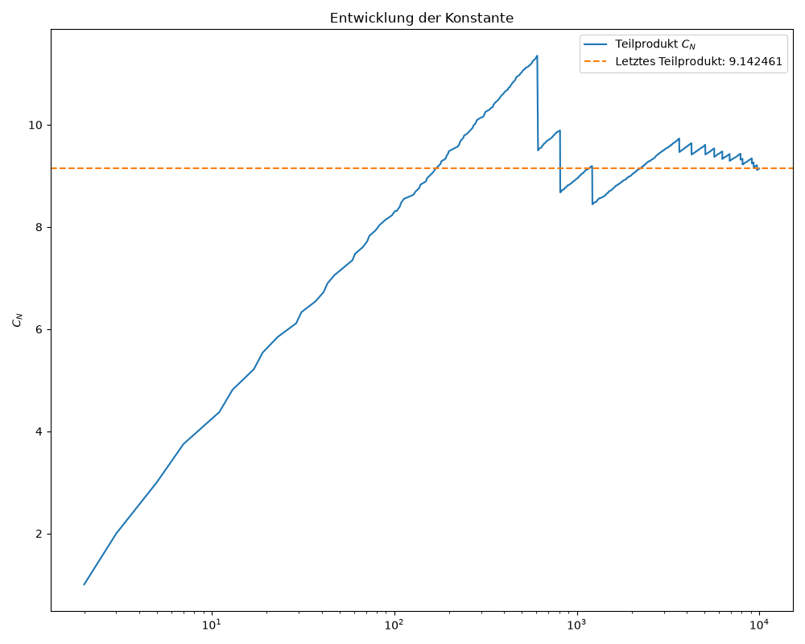
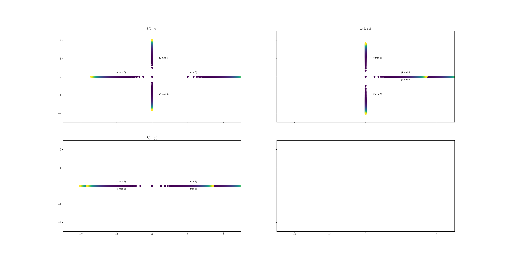

# Kunst – Zahlentheorie mit Python

Numerische Experimente und Visualisierungen zu Primzahlen, Eulerprodukten und Bateman-Horn-Konstanten. Die Skripte vergleichen gezählte Primwerte mit theoretischen Näherungen, untersuchen Siebprodukte für Kreisteilungspolynome und zeichnen Teilsummen nach Restklassen modulo 5.



*Vergleich der Kreisteilungspolynome mit Primzahlindizes von 2 bis 71.*

## Experimente

| Skript | Inhalt | Standardeinstellung |
| --- | --- | --- |
| [arithmeticProgression.py](scripts/arithmeticProgression.py) | Zählt Primzahlen in einer arithmetischen Progression und vergleicht die Anzahl mit zwei Näherungen. | 10.000 Glieder der Folge `1 + 4i`, beginnend bei `i = 0`. |
| [KonstanteBeispiel.py](scripts/KonstanteBeispiel.py) | Stellt Teilprodukte der Bateman-Horn-Konstante für das Polynompaar $x^5+2$ und $x^4+2$ dar. | Feste Primzahlliste bis 9.973. |
| [101Kreisteilungspolynom.py](scripts/101Kreisteilungspolynom.py) | Untersucht das Eulerprodukt für das Kreisteilungspolynom $\Phi_{101}$. | Feste Primzahlliste bis 9.973. |
| [kreisteilunsploynome.py](scripts/kreisteilunsploynome.py) | Vergleicht Teilprodukte für $\Phi_\ell$, wobei $\ell$ die ersten 20 Primzahlen durchläuft. | Primzahlgrenze `cutoff = 100_000`. Nach dem Schließen des Diagramms erscheinen die letzten Teilprodukte im Terminal. |
| [VergleichPhi5.py](scripts/VergleichPhi5.py) | Zählt die Primwerte von $\Phi_5(n)=n^4+n^3+n^2+n+1$ für $2\le n<x$ und vergleicht sie mit der Bateman-Horn-Näherung und einer als „Schranke“ beschrifteten Kurve. | $x$ läuft von 2 bis 10.000. Die Detailansicht zeigt Zählung und Näherung. |
| [primefinder101.py](scripts/primefinder101.py) | Prüft ab $n=0$, welche Werte von $\Phi_5(n)$ unter 10.000 prim sind. | Terminalausgabe `3 10` für drei Primwerte bei zehn geprüften Argumenten. |
| [Sieben.py](scripts/Sieben.py) | Zeichnet für $\Phi_7$ das fortlaufende Siebprodukt der Faktoren $1-\omega(p)/p$. | Die ersten 10.000 Primzahlen aus `primzahlen.txt`. Nach dem Schließen des Diagramms vergleicht das Skript das letzte Produkt mal 1.000 mit $1000/6$. |
| [charakter.py](scripts/charakter.py) | Zeichnet Teilsummen der Terme $\chi(n)/n$ in der komplexen Ebene, getrennt nach den vier von null verschiedenen Restklassen modulo 5. | Drei Teilbilder für die in `L1`, `L2` und `L3` definierten Werte, mit $1\le n<10\,000$. |
| [Erster.py](scripts/Erster.py) | Explorative Sammlung mit Funktionen zum Eulerprodukt und zur Möbiusfunktion. Beim Start wird $\log(x^4+1)\log(x^5+1)$ mit $20(\log x)^2$ verglichen. | Ganzzahlige Argumente von 1 bis 99. |

## Projektstruktur

```text
Kunst/
├── README.md
├── requirements.txt
├── .gitignore
├── .gitattributes
├── scripts/
│   ├── arithmeticProgression.py
│   ├── KonstanteBeispiel.py
│   ├── 101Kreisteilungspolynom.py
│   ├── kreisteilunsploynome.py
│   ├── Erster.py
│   ├── VergleichPhi5.py
│   ├── primefinder101.py
│   ├── Sieben.py
│   ├── charakter.py
│   └── primzahlen.txt
└── figures/
    ├── Visualisierung_Arithmetic_Progression.png
    ├── KonvergenzKonstante.png
    ├── Kreisteilung101.png
    ├── VergleichKreisteilungMitPrimordnung.png
    ├── VergleichPhi%.png
    └── LfunctionsMod5.png
```

- **`scripts/`** enthält die Experimente und die [Primzahlliste](scripts/primzahlen.txt). Jede Zeile der Liste enthält eine Zahl.
- **`figures/`** enthält die mitgelieferten PNG-Abbildungen und kann für weitere Diagramme verwendet werden.
- **`requirements.txt`** führt die benötigten Python-Pakete auf.
- **`.gitignore`** hält virtuelle Umgebungen, Python-Zwischendateien und lokale Einstellungen aus dem Repository heraus.
- **`.gitattributes`** legt einheitliche Zeilenenden für Textdateien fest und kennzeichnet PNG-Dateien als Binärdateien.

## Installation und erster Start

Für alle neun Skripte zusammen brauchst du Python 3.10 oder neuer (`charakter.py` verwendet `match`) und für die Diagrammfenster eine grafische Desktop-Umgebung. Die Installation über [requirements.txt](requirements.txt) richtet Matplotlib, NumPy, SciPy und SymPy ein. Das von `VergleichPhi5.py` importierte Paket mpmath wird mit SymPy installiert. Für die Beschriftungen in `charakter.py` muss zusätzlich eine LaTeX-Installation über den Suchpfad erreichbar sein.

Öffne ein Terminal im Hauptordner des heruntergeladenen oder geklonten Repositorys.

### Windows / PowerShell

```powershell
python -m venv .venv
.\.venv\Scripts\python.exe -m pip install -r requirements.txt
.\.venv\Scripts\python.exe scripts/arithmeticProgression.py
```

Die Befehle rufen Python direkt aus der virtuellen Umgebung auf.

### Linux / macOS

```bash
python3 -m venv .venv
./.venv/bin/python -m pip install -r requirements.txt
./.venv/bin/python scripts/arithmeticProgression.py
```

## Weitere Experimente starten

Diese Skripte kannst du einzeln im Hauptordner starten. Bei den grafischen Experimenten kehrst du durch Schließen des Diagrammfensters zum Terminal zurück.

```powershell
.\.venv\Scripts\python.exe scripts/KonstanteBeispiel.py
.\.venv\Scripts\python.exe scripts/101Kreisteilungspolynom.py
.\.venv\Scripts\python.exe scripts/kreisteilunsploynome.py
.\.venv\Scripts\python.exe scripts/Erster.py
.\.venv\Scripts\python.exe scripts/charakter.py
.\.venv\Scripts\python.exe scripts/primefinder101.py
```

Unter Linux und macOS ersetzt du `.\.venv\Scripts\python.exe` durch `./.venv/bin/python`.

### Experimente mit der Primzahlliste starten

`VergleichPhi5.py` und `Sieben.py` öffnen `primzahlen.txt` relativ zum aktuellen Arbeitsverzeichnis. Wechsle für diese beiden Skripte vom Hauptordner nach `scripts/`.

**Windows / PowerShell**

```powershell
cd scripts
..\.venv\Scripts\python.exe VergleichPhi5.py
..\.venv\Scripts\python.exe Sieben.py
cd ..
```

**Linux / macOS**

```bash
cd scripts
../.venv/bin/python VergleichPhi5.py
../.venv/bin/python Sieben.py
cd ..
```

### Parameter anpassen

Die Experimente werden über die Python-Dateien konfiguriert. Ersetze für einen kleineren Durchlauf den jeweiligen Funktionsaufruf am Dateiende.

```python
# In scripts/arithmeticProgression.py
malen(a=3, m=4, limit=5_000)

# In scripts/kreisteilunsploynome.py
malen(cutoff=10_000)

# In scripts/VergleichPhi5.py
zeichne_vergleich(1_000)
```

Bei der arithmetischen Progression bezeichnet `limit` die Anzahl der betrachteten Folgeglieder. `a` und `m` müssen positive, teilerfremde ganze Zahlen sein. Beim Kreisteilungsvergleich bezeichnet `cutoff` die obere Primzahlgrenze und muss mindestens 2 betragen. Bei `zeichne_vergleich(x_max)` ist `x_max` der letzte dargestellte Wert von $x$. Der zugehörige Zählwert berücksichtigt die Argumente bis einschließlich $n=x_{\max}-1$.

### Diagramme speichern

Über das Speichersymbol im Matplotlib-Fenster kannst du neue Abbildungen als PNG in `figures/` ablegen. Die mitgelieferten PNGs werden beim Start der Skripte nicht automatisch aktualisiert.

## Mathematischer Hintergrund

Die Bateman-Horn-Vermutung beschreibt die erwartete Häufigkeit gemeinsamer Primwerte geeigneter Polynome. Die zugehörige Konstante enthält ein Eulerprodukt. In den Konstanten-Experimenten werden endliche Teilprodukte der Form

$$
C_Q = \prod_{\substack{p\leq Q\\p\;\mathrm{prim}}}
\left(1-\frac{1}{p}\right)^{-k}
\left(1-\frac{\omega(p)}{p}\right)
$$

untersucht. Dabei ist $k$ die Anzahl der Polynome und $\omega(p)$ die Anzahl der Restklassen modulo $p$, in denen ihr Produkt verschwindet. Eine ausführliche Darstellung bietet [*The Bateman-Horn Conjecture: Heuristics, History, and Applications*](https://arxiv.org/abs/1807.08899) von Soren Laing Aletheia-Zomlefer, Lenny Fukshansky und Stephan Ramon Garcia.

Für das Polynompaar $x^5+2$, $x^4+2$ gilt $k=2$. Bei einem einzelnen Kreisteilungspolynom gilt $k=1$. Die Diagramme zeigen endliche Teilprodukte. Für $\Phi_5$ zeichnet `VergleichPhi5.py` die Näherung $C_x\,\mathrm{li}(x)/4$ und die Vergleichskurve $2C_x\,\mathrm{li}(x)$. Die 4 im Nenner ist der Grad des Polynoms.

Das Progressionsskript vergleicht die tatsächliche Primzahlanzahl mit Ausdrücken auf Basis von $x/(\varphi(m)\log x)$ und dem logarithmischen Integral, jeweils für das betrachtete Intervall. Im Programm wird das Integral ab 2 verwendet.

## Hinweise zum aktuellen Stand

- In `KonstanteBeispiel.py` und `101Kreisteilungspolynom.py` prüft `malen(limit=...)` den Parameter, verwendet ihn aber noch nicht zur Begrenzung der Berechnung.
- Bei beiden Skripten enthält jeder dargestellte Wert die Faktoren der jeweils vorangegangenen Primzahlen. Beim ersten Punkt steht daher das leere Produkt `1`. Der Punkt bei 9.973 enthält die Faktoren bis 9.967.
- `Erster.py`, `KonstanteBeispiel.py`, `101Kreisteilungspolynom.py`, `Sieben.py` und `charakter.py` öffnen ihr Diagramm auch beim Import. `primefinder101.py` führt beim Import seine Zählung aus.
- In `charakter.py` verwendet `L3` für die Restklasse 4 modulo 5 den Wert $+1$. Für den zu `L1` komplex konjugierten Dirichlet-Charakter wäre der Wert $-1$. Das betrifft die Punkte dieser Restklasse im Teilbild $L(1,\chi_3)$.
- Die Eulerprodukt- und Möbius-Plotbeispiele in `Erster.py` stehen in mehrzeiligen Zeichenketten und werden beim normalen Start nicht ausgeführt.

## Weitere Beispielabbildungen

<details>
<summary>Primzahlen in einer arithmetischen Progression</summary>



</details>

<details>
<summary>Teilprodukte für das Polynompaar</summary>



</details>

<details>
<summary>Teilprodukte für das Kreisteilungspolynom Phi 101</summary>



</details>

<details>
<summary>Primwerte des Kreisteilungspolynoms Phi 5</summary>


</details>

<details>
<summary>Teilsummen nach Restklassen modulo 5</summary>



</details>
